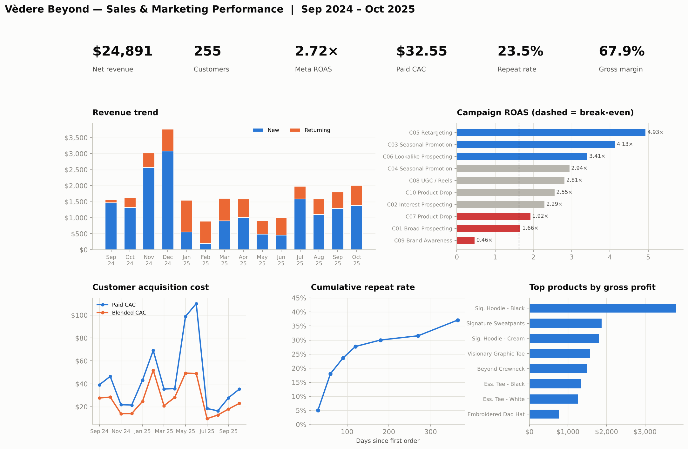
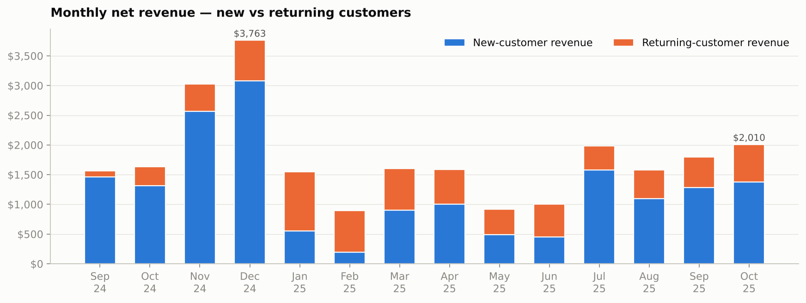
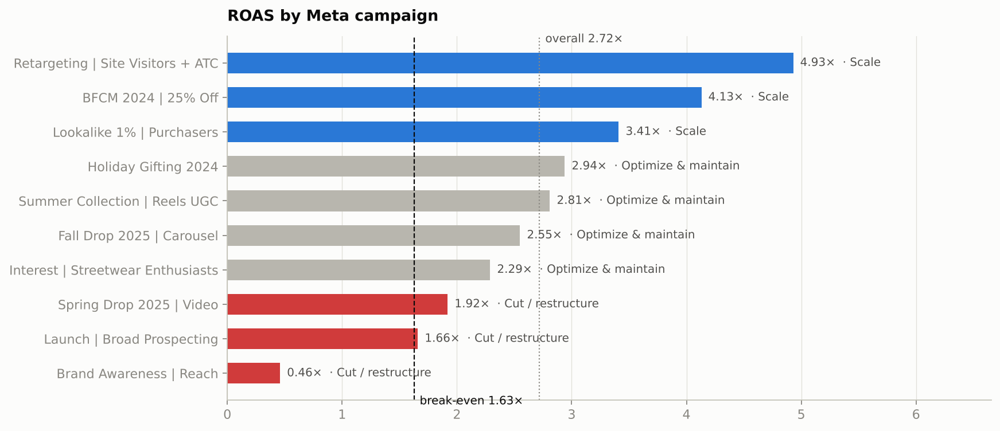
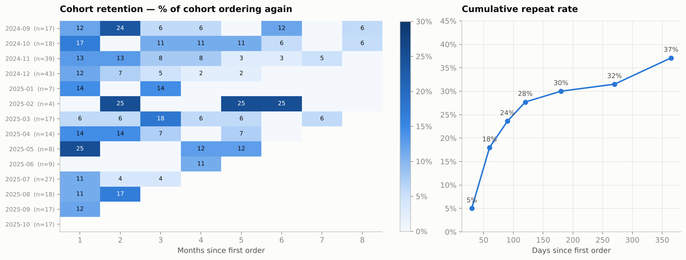
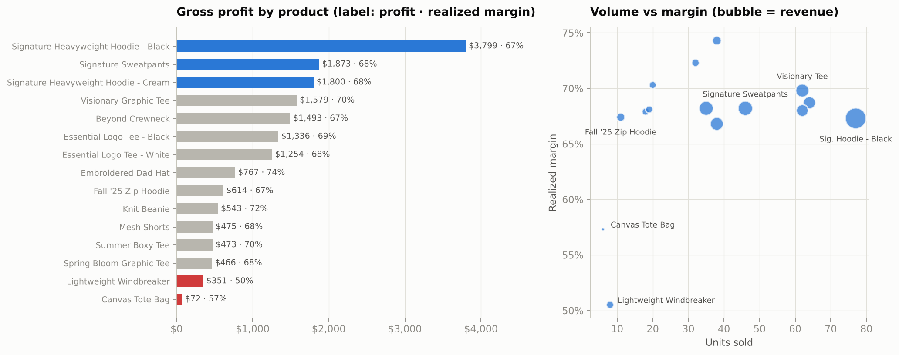
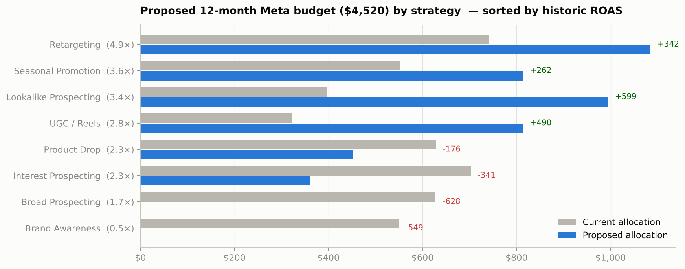

# Vèdere Beyond — Sales & Marketing Analytics

**Python · SQL (SQLite) · Tableau · Jupyter**

An end-to-end analytics project for **Vèdere Beyond**, my independent clothing brand. Over 14 months the business generated **more than $20,000 in revenue from more than 240 customers, at roughly 2.5–3× return on ad spend** on Meta (Facebook / Instagram). This project rebuilds that business as a data model and answers the questions that decide where the next marketing dollar goes:

- Which **products** actually make money?
- Which **Meta campaigns, audiences and creatives** earn their budget?
- What does a **customer cost to acquire**, and what are they **worth**?
- Do customers **come back**, and when?
- How should the **ad budget be reallocated**?



> **Data note.** The brand's raw records are not published. The dataset here is **synthetic**: it is generated by `scripts/01_generate_data.py` and calibrated to the real headline results (> $20K revenue, > 240 customers, 2.5–3.0× ROAS). Totals match the real business. Order-level detail, customer identities and the campaign and product splits are simulated, so read the findings as a worked analysis of a realistic brand, not as audited figures.

---

## Headline results

| Metric | Value |
|---|---|
| Period | Sep 2024 – Oct 2025 (14 months) |
| Net revenue (after discounts & refunds) | **$24,891** |
| Unique customers | **255** |
| Orders / AOV | 341 paid orders · $72.99 |
| Meta ad spend | $5,273 |
| **Meta-attributed ROAS** | **2.72×** (break-even 1.63×) |
| Blended MER (all revenue ÷ ad spend) | 4.72× |
| Paid CAC / blended CAC | $32.55 / $20.68 |
| Repeat purchase rate | 23.5% |
| Gross margin | 67.9% |
| Profit after COGS, fulfillment, fees & ads | $10,093 |

---

## Project structure

```
├── run_pipeline.py                  # rebuilds everything end to end
├── requirements.txt
├── data/
│   ├── raw/                         # messy synthetic exports (Shopify-style orders, Meta Ads Manager report, ...)
│   ├── processed/                   # cleaned, analysis-ready tables + cleaning_log.txt
│   └── vedere_beyond.db             # SQLite database
├── scripts/
│   ├── 01_generate_data.py          # synthetic data generator (seeded, calibrated)
│   ├── 02_clean_transform.py        # cleaning, standardization, joins, unit economics
│   ├── 03_build_database.py         # schema + load + views + integrity checks
│   ├── 04_run_analysis.py           # runs all SQL, campaign actions, budget model
│   ├── 05_export_tableau.py         # Tableau-ready extracts
│   └── vb_analytics.py              # shared helpers + budget reallocation model
├── sql/
│   ├── schema.sql                   # tables, keys, indexes
│   ├── views.sql                    # v_order_lines, v_campaign_performance, v_monthly_kpis
│   └── analysis/01–14_*.sql         # one analytical question per file
├── notebooks/
│   └── vedere_beyond_analysis.ipynb # full documented analysis (executed, with outputs)
├── reports/
│   ├── figures/                     # charts exported by the notebook
│   └── query_results/               # CSV output of every SQL query + budget plan
└── tableau/
    ├── DASHBOARD_GUIDE.md           # data sources, calculated fields, sheets, layout
    └── data/                        # denormalized extracts for Tableau
```

## How to run

```bash
pip install -r requirements.txt
```

```bash
python run_pipeline.py
```

The pipeline is deterministic (seed `313`), so a rebuild reproduces every number in this README. To run a single stage, call its script, e.g. `python scripts/04_run_analysis.py`. To explore the data directly, open `data/vedere_beyond.db` in any SQLite client.

---

## Methodology

### 1. Synthetic data generation (`01_generate_data.py`)
The generator works bottom-up so that every dataset agrees with the others:

1. **Product catalog.** 15 SKUs across tees, hoodies, crewnecks, bottoms, outerwear and accessories, released in drops (Core, Fall/Winter '24, Spring '25, Summer '25, Fall '25), each with its own retail price, unit cost and popularity.
2. **Meta campaign plan.** 10 campaigns covering broad, interest and lookalike prospecting, retargeting, seasonal promotions, product drops, UGC Reels and brand awareness, each with its own dates, audience, creative, CPM and CTR.
3. **Customers.** 255 customers. Meta-acquired customers get a first purchase date inside their campaign's flight. Organic customers (Instagram, referral, TikTok, two pop-up events) follow weekday and seasonal weights.
4. **Orders.** First and repeat orders. Repeat probability depends on channel, and gaps between orders follow a log-normal distribution. Each basket favors products the customer's campaign featured and in-season categories. Discount codes (BFCM25, SUMMER20, WELCOME10, VIP15), shipping thresholds and about 3% refunds are applied.
5. **Ad delivery.** Purchases and purchase value in the Meta report come from the attributed orders. Spend is then backed out of each campaign's target efficiency and scaled so that overall ROAS lands at 2.72×. Impressions, reach, clicks, landing-page views, add-to-carts and checkouts are derived from campaign-specific CPM, CTR and conversion rates.
6. **Realistic mess.** Duplicate rows, upper-case and padded emails, state names written out in full, MM/DD/YYYY timestamps, `$1,234.00` currency strings, test orders, zero-quantity lines, blank conversion cells in the Meta export, and 10% of customers who skipped the "How did you hear about us?" survey.

### 2. Cleaning & transformation (`02_clean_transform.py`)
- De-duplication, email and state normalization, mixed-format date parsing, currency parsing, test-order removal.
- **Entity resolution.** Orders are linked to customers by normalized email, and UTM campaign slugs are mapped to campaign IDs.
- **Attribution.** Each order gets a channel (Meta Ads, Instagram Organic, Referral, TikTok, Pop-up, Email, SMS, Direct). Each customer's acquisition channel comes from the survey, or from the first order's UTM tags when the survey was skipped. A pixel-attributed first purchase overrides the survey.
- **Unit economics per order:** gross sales → discounts → net sales; COGS; fulfillment ($5.50 + $0.50 per extra unit); payment fees (2.9% + $0.30 online, 2.6% + $0.10 POS); contribution margin.
- **Reconciliation check.** Meta-reported purchase value must match Shopify net sales for every campaign. Order line items must add up to each order's subtotal.

### 3. SQLite database & SQL analysis
A star-style schema (`orders`, `order_items` and `ad_performance_daily` facts, plus `customers`, `products` and `ad_campaigns` dimensions) with foreign keys, indexes and three reusable views. The 14 analysis queries use CTEs, window functions (`RANK`, `LAG`, running `SUM`, `ROW_NUMBER`, percent-of-total), conditional aggregation and month arithmetic for cohorts:

| Query | Question |
|---|---|
| `01_kpi_summary` | Headline KPIs, ROAS, MER, CAC |
| `02_monthly_revenue_trend` | Revenue, new vs returning, MoM growth, cumulative revenue |
| `03_customer_acquisition_cost` | Paid and blended CAC by month |
| `04_cac_ltv_by_channel` | Repeat rate, LTV and LTV:CAC by acquisition channel |
| `05_repeat_purchase_rate` | Order-count distribution, days to 2nd order |
| `06_campaign_roas` | Campaign scorecard: ROAS, CPM, CTR, CPA, profit after ads |
| `07_roas_by_strategy_creative` | ROAS by strategy and creative format |
| `08_product_margins` / `09_category_margins` | Product and category profitability |
| `10_cohort_retention` / `11_cumulative_retention_curve` | Monthly cohorts and repeat-rate curve |
| `12_new_vs_returning_and_discounts` | Discount-code impact on AOV and margin |
| `13_campaign_monthly_roas` / `14_top_products_by_campaign` | Campaign trends and which products each campaign sells |

### 4. Budget reallocation model (`vb_analytics.reallocation_plan`)
- **Break-even ROAS** = 1 ÷ contribution-margin rate on ad-driven orders (61.3%) = **1.63×**.
- Each campaign is labeled **Scale** (ROAS ≥ 3×), **Optimize & maintain** (≥ 1.25 × break-even) or **Cut / restructure**.
- The forward 12-month budget is held flat at the historical run rate ($4,520), so any gain comes from reallocation alone.
- Cuts lose revenue at the strategy's historical ROAS (a conservative assumption). Increases follow a concave response curve, *revenue ∝ spend^0.7*, to reflect saturation. Retargeting is capped at +60% because its warm audience is finite.

### 5. Tableau dashboard
`05_export_tableau.py` writes nine denormalized, PII-free extracts. [`tableau/DASHBOARD_GUIDE.md`](tableau/DASHBOARD_GUIDE.md) specifies relationships, calculated fields (ROAS, CAC, LTV, margin, break-even action), 12 worksheets and three dashboards: Executive Overview, Advertising Performance, and Customers & Products. The notebook renders a static preview of the overview layout (shown above).

---

## Key findings

### Revenue

- **Q4 drives the year.** BFCM and holiday (Nov–Dec 2024) brought in $6.8K, which is **27% of 14-month revenue in 2 months**.
- Revenue fell 59% in January and another 42% in February as ad spend dropped to about $170–210/month. In those months, returning customers carried most of the revenue.
- Product drops (Spring, Summer, Fall '25) and the July pop-up each produced visible step-ups.

### Advertising


| | Campaign | ROAS | Spend share → revenue share |
|---|---|---|---|
| 🥇 | Retargeting – Site Visitors + ATC (dynamic product ads) | **4.93×** | 16% → 30% |
| 🥈 | BFCM 2024 – 25% Off | **4.13×** | 7% → 11% |
| 🥉 | Lookalike 1% – Purchasers (UGC video) | **3.41×** | 9% → 11% · cheapest new customer ($17) |
| ⚠️ | Spring Drop – Studio Video | 1.92× | 5% → 3.5% |
| ⚠️ | Launch – Broad Prospecting | 1.66× (≈ break-even) | 14% → 8.5% |
| ❌ | Brand Awareness – Reach | **0.46×** | 12% → 2% · $213 per customer |

- The three weakest campaigns took **31% of spend and returned 14% of attributed revenue**.
- **Creative format matters as much as audience.** UGC formats returned about 3.1× and polished studio video about 0.9×. Reels UGC had the lowest CPM in the account ($8.46).

### Customers

- **Paid CAC is $32.55** against about $60 of observed lifetime contribution per Meta-acquired customer, so **LTV:CAC is about 1.9×**: profitable, but thin. CAC rose to $99–110 in May–June 2025, the months the awareness campaign ran.
- **23.5% of customers have bought again.** The second purchase comes early or not at all: the cumulative repeat rate is 5% at day 30, **24% at day 90**, and levels off near 30% by day 180.
- Organic Instagram and referral customers repeat at about 33%, compared with about 20% for Meta-acquired customers.

### Products

- **The Signature Heavyweight Hoodie (Black + Cream) accounts for 33% of revenue and $5.6K of gross profit.** Together with the Signature Sweatpants, the "Signature" line is about 44% of revenue.
- Hoodies are the most profitable category: 37% of revenue at a 68% margin.
- The **Fall '25 Zip Hoodie** earns the most gross profit per month on sale (about $323 per 30 days).
- The **Windbreaker (51% margin)** and **Canvas Tote (57%)** lag every other product on margin and sold fewer than 10 units each.

---

## Recommendations — reallocating the ad budget



| Strategy | Historical ROAS | Current share | Proposed share | Change (12-mo) |
|---|---|---|---|---|
| Retargeting | 4.93× | 16% | **24%** | +$342 |
| Lookalike prospecting (UGC) | 3.41× | 9% | **22%** | +$599 |
| Seasonal promotion (BFCM / holiday) | 3.65× | 12% | **18%** | +$262 |
| UGC / Reels | 2.81× | 7% | **18%** | +$490 |
| Product drops | 2.32× | 14% | 10% | −$176 |
| Interest prospecting | 2.29× | 16% | 8% | −$341 |
| Broad prospecting | 1.66× | 14% | **0%** | −$628 |
| Brand awareness | 0.46× | 12% | **0%** | −$549 |

**Projected impact at the same $4,520 budget:** attributed revenue **$12.3K → $13.6K (+11%)**, ROAS **2.72× → 3.01×**, profit after ad spend **$3.0K → $3.8K (+26%)**.

1. **Pause Brand Awareness and Broad Prospecting.** Together they take 26% of budget at or below break-even.
2. **Scale lookalike audiences built from purchasers, with UGC video.** This is the cheapest source of genuinely *new* customers, at about $17 each.
3. **Grow UGC / Reels and retire studio-produced video.** Commission 3–4 UGC creators per product drop.
4. **Raise always-on retargeting to 24%**, capped by audience size, with dynamic product ads featuring the Signature line.
5. **Concentrate promotions on BFCM and holiday.** Run lookalike prospecting in Oct–Nov first so the retargeting pools are full when the sale opens.
6. **Launch product drops with carousel and UGC creative**, and lead fall creative with the Fall '25 Zip Hoodie.

**Retention and product**

7. Build a **30/60/90-day post-purchase email/SMS flow** and a **Q1 win-back** for holiday buyers. Raising the 90-day repeat rate from 24% to 30% adds about 15 orders per 250 new customers.
8. Replace the blanket VIP15 discount with **"complete the set" cross-sells** (hoodie → sweatpants). VIP15 repeat orders run at a 58% contribution margin vs 63% for full-price repeats.
9. **Make the Signature Heavyweight line the hero:** keep core colorways in stock, test a third colorway, and bundle around it.
10. **Discontinue or re-cost the Windbreaker and Tote.** Use the tote as a free gift above an order-value threshold instead.

## Business implications
- **Profit comes from where the money goes, not how much is spent.** The same budget, reallocated, is projected to earn about $800 more profit per year, which is meaningful for a brand netting about $10K after ads.
- **The brand runs on one product line.** That is efficient for inventory and creative, but it is a concentration risk, so new drops should be judged on profit per month on sale, not launch hype.
- **Retention is the cheapest growth lever.** At a $33 CAC and about $60 LTV contribution, every point of repeat rate is worth more than another point of ROAS.

## Limitations & next steps
- Synthetic data, calibrated to real totals. The campaign and product splits are illustrative.
- Meta's attribution (7-day click / 1-day view) **over-credits retargeting**. Run a holdout or conversion-lift test before scaling it further.
- The 0.7 spend elasticity is an assumption. Validate it with staged budget increases (e.g. +25% for 3 weeks).
- LTV is observed, not predicted, and recent cohorts are right-censored. A BG/NBD or Gamma-Gamma model would give forward-looking CLV.
- Next steps: connect live Shopify and Meta Marketing API exports in place of the generator, schedule the pipeline, and publish the dashboard to Tableau Public.
